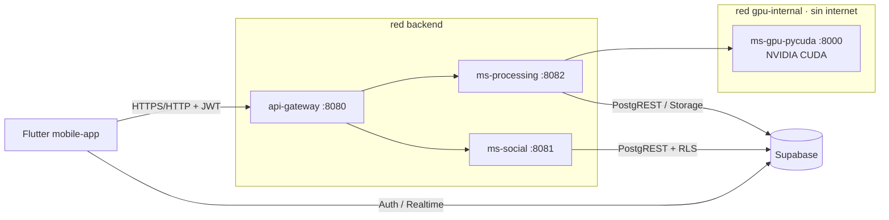

# UPSGlam Platform

Red social móvil de fotografía con **procesamiento paralelo de imágenes en GPU**
(filtros CUDA propios ejecutados con PyCUDA). Proyecto interciclo de
Computación Paralela — Universidad Politécnica Salesiana.

## Arquitectura



| Componente | Stack | Responsabilidad |
|---|---|---|
| `mobile-app/` | Flutter | Cliente: login con Supabase Auth, feed, estudio de filtros, perfil. |
| `services/api-gateway/` | Spring Cloud Gateway (WebFlux) | Único punto de entrada: valida JWT, propaga identidad, enruta, timeouts y circuit breaker. |
| `services/ms-social/` | Spring WebFlux | Perfiles, publicaciones, comentarios y likes sobre PostgREST. |
| `services/ms-processing/` | Spring WebFlux | Orquesta trabajos de procesamiento, Storage, historial y métricas GPU. |
| `services/ms-gpu-pycuda/` | FastAPI + PyCUDA | Ejecuta los 6 kernels CUDA con concurrencia acotada (429 al saturarse). |
| Supabase | PostgreSQL · Auth · Storage · Realtime | Persistencia con Row Level Security, autenticación y archivos. |

## Requisitos

- Docker Engine con Docker Compose v2.
- GPU NVIDIA con driver instalado y **NVIDIA Container Toolkit** (ver
  [gpu-environment.md](docs/architecture/gpu-environment.md)).
- Proyecto de Supabase con las migraciones de `docs/database/migrations/` aplicadas.
- Para desarrollo local: JDK 21+, Flutter SDK.

## Puesta en marcha

```bash
# 1. Configuración (nunca se versiona .env)
cp .env.example .env        # completar con los datos del proyecto Supabase

# 2. Base de datos: ejecutar en el SQL Editor de Supabase, en orden
#    docs/database/migrations/001_initial_schema.sql
#    docs/database/migrations/002_restrict_processing_updates.sql
#    docs/database/migrations/seed.sql

# 3. Levantar el stack (cada servicio espera a que sus dependencias estén healthy)
docker compose up -d --build
docker compose ps

# 4. Verificación
curl -s localhost:8080/actuator/health      # {"status":"UP"}
curl -s localhost:8080/api/v1/social/posts  # 401 sin token
```

La app móvil apunta por defecto a `http://10.0.2.2:8080/api/v1` (emulador
Android); en un dispositivo físico configure la IP de la máquina host desde la
pantalla de ajustes de la API.

## Documentación

| Documento | Contenido |
|---|---|
| [docs/architecture/openapi.yaml](docs/architecture/openapi.yaml) | Contrato REST (Contract-First) de todos los endpoints. |
| [docs/architecture/api-gateway.md](docs/architecture/api-gateway.md) | Seguridad JWT, enrutamiento, errores, configuración y pruebas del Gateway. |
| [docs/architecture/concurrency-policy.md](docs/architecture/concurrency-policy.md) | Semáforo GPU, cola acotada, rechazo 429 y recuperación de trabajos huérfanos. |
| [docs/architecture/filters.md](docs/architecture/filters.md) | Catálogo matemático de los 6 filtros CUDA. |
| [docs/architecture/gpu-environment.md](docs/architecture/gpu-environment.md) | Requisitos NVIDIA, imagen CUDA y política sin fallback a CPU. |
| [docs/database/migrations/](docs/database/migrations/) | Esquema, políticas RLS, Storage, Realtime y datos semilla. |
| [docs/evidence/](docs/evidence/README.md) | Evidencias de ejecución GPU y pruebas de carga para la defensa. |

## Pruebas

```bash
# Unitarias / integración (por servicio Java)
cd services/api-gateway && ./mvnw clean verify

# Carga y concurrencia GPU (k6) contra el Gateway
k6 run -e API_BASE_URL=http://localhost:8080/api/v1 load-tests/gpu_concurrency_test.js
```

## Seguridad

- Los secretos viven solo en `.env` (ignorado por git); `.env.example` contiene
  únicamente placeholders.
- Solo el Gateway publica un puerto; el servicio GPU está en una red sin salida
  a internet.
- Contenedores sin root, `no-new-privileges`, `cap_drop: ALL` y límites de memoria.
- El acceso a datos se autoriza con RLS de Supabase usando el JWT del usuario;
  `SUPABASE_SERVICE_ROLE_KEY` se reserva para tareas de sistema de `ms-processing`.

## Estado

| Componente | Estado |
|---|---|
| api-gateway | ✅ Implementado y probado (14 pruebas de integración) |
| Infraestructura Docker | ✅ Imágenes y compose verificados (GPU RTX 50xx / CUDA 13.4) |
| ms-gpu-pycuda | 🚧 Esqueleto: health operativo, kernels pendientes |
| ms-social | 🚧 Esqueleto: casos de uso sin registrar como beans |
| ms-processing | 🚧 Esqueleto |
| mobile-app | 🚧 En desarrollo |
