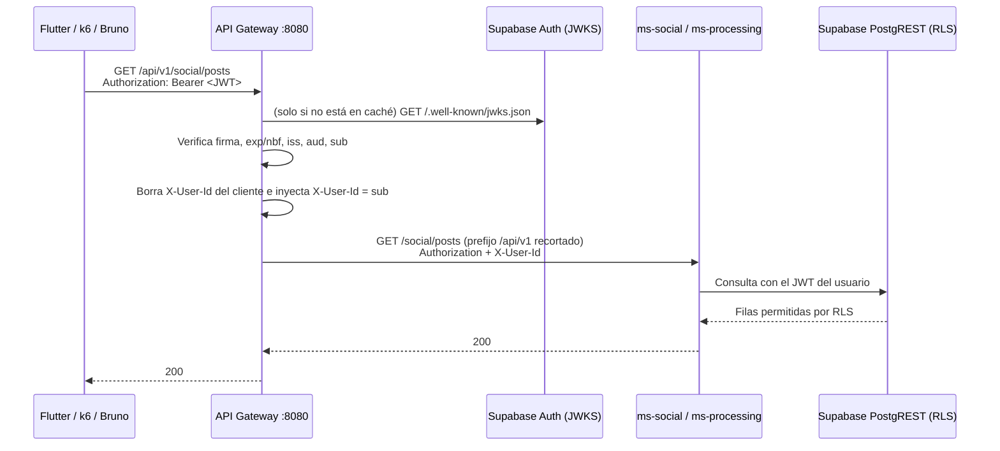

<!--
Capa: Infrastructure / Architecture Documentation
Responsabilidad: Documentar el diseño, la seguridad, el enrutamiento, la
  configuración, la operación y las pruebas del API Gateway (borde único de la
  plataforma UPSGlam).
Regla de Dependencia: Referencia técnica para services/api-gateway/ y su
  bloque en docker-compose.yml. Debe mantenerse alineado con openapi.yaml.
-->
# API Gateway (`services/api-gateway`)

Único punto de entrada público de UPSGlam. Valida la identidad del usuario
(JWT de Supabase Auth), propaga esa identidad a los microservicios internos y
los protege con timeouts, límites de tamaño y circuit breaker. **No contiene
lógica de negocio.**

| Aspecto | Valor |
|---|---|
| Stack | Java 21 · Spring Boot 4.2 · Spring Cloud Gateway (WebFlux) 2026.0 · Spring Security OAuth2 Resource Server · Resilience4j |
| Puerto | `8080` (único puerto publicado en el host, `GATEWAY_PORT`) |
| Red Docker | `backend` (con salida a internet para descargar el JWKS de Supabase) |
| Imagen | Multi-stage `eclipse-temurin:21-jdk` → `21-jre`, usuario sin privilegios `app` (uid 10001) |

## 1. Flujo de una petición



## 2. Seguridad

### 2.1 Validación del JWT
Implementada en `security/SupabaseJwtDecoderConfig.java` con
`NimbusReactiveJwtDecoder` (no bloqueante; caché y refresco del JWKS
gestionados por Spring Security).

| Verificación | Regla |
|---|---|
| Firma (primaria) | ES256 o RS256 con las claves públicas de `SUPABASE_JWKS_URL`. Cualquier otro algoritmo se rechaza. |
| Firma (legado, opcional) | HS256 con `SUPABASE_JWT_SECRET`, **solo si** la variable está definida y tiene ≥ 32 bytes. Si es más corta, el Gateway no arranca. |
| `exp` / `nbf` | Obligatorio / respetado, con 60 s de tolerancia de reloj. |
| `iss` | Debe ser exactamente `${SUPABASE_URL}/auth/v1`. |
| `aud` | Debe contener `authenticated` (excluye tokens `anon` y `service_role`). |
| `sub` | Obligatorio y no vacío (UUID del usuario). |

**Sin confusión de algoritmos:** cuando HS256 está habilitado, el header `alg`
solo decide a qué decoder se consulta; cada decoder acepta exclusivamente su
propio algoritmo y su propia clave. El header nunca elige la clave.

> El proyecto Supabase actual firma con **ES256 (EC P-256)**. Si ya no existen
> tokens HS256 legados, deje `SUPABASE_JWT_SECRET` vacío para deshabilitar ese
> camino (el Gateway lo advierte en el log al arrancar mientras esté activo).

### 2.2 Reglas de autorización (`security/SecurityConfig.java`)

| Ruta | Acceso |
|---|---|
| `/actuator/health`, `/actuator/health/**` | Público (healthchecks de Docker). |
| `/api/v1/**` | Requiere JWT válido. |
| Cualquier otra (`/internal/**`, `/fallback/**`, resto de `/actuator/**`, …) | Denegada (401 sin token, 403 con token). |

API stateless: sin sesión, CSRF, form login, basic auth ni usuario por defecto.
CORS no se configura porque los clientes (Flutter nativo, k6, Bruno) no son
navegadores; si en el futuro hay un cliente web, se debe agregar con una lista
explícita de orígenes, nunca `*`.

### 2.3 Propagación de identidad (`filter/UserIdentityHeaderFilter.java`)
- **Siempre** elimina el `X-User-Id` que envíe el cliente (anti-suplantación).
- Inyecta `X-User-Id` con el claim `sub` del token ya validado.
- Reenvía `Authorization: Bearer <JWT>` intacto para que PostgREST aplique RLS
  con la identidad del usuario.

Los microservicios internos solo son alcanzables desde la red Docker (`expose`,
no `ports`), por lo que `X-User-Id` únicamente puede provenir del Gateway.

## 3. Enrutamiento (`config/GatewayRoutesConfig.java`)

La versión de la API vive solo en el borde: el Gateway recorta `/api/v1`.

| Ruta pública | Destino interno | Timeout | Circuit breaker |
|---|---|---|---|
| `/api/v1/social/**` | `http://ms-social:8081/social/**` | `MS_SOCIAL_TIMEOUT` (10 s) | `socialCircuitBreaker` |
| `/api/v1/processing/**` | `http://ms-processing:8082/processing/**` | `MS_PROCESSING_TIMEOUT` (60 s, por la GPU) | `processingCircuitBreaker` |

Por lo tanto, los controladores internos se mapean **sin** prefijo de versión
(p. ej. `@RequestMapping("/social/posts")`, `@RequestMapping("/processing")`).

Filtros aplicados a ambas rutas:
- **RequestSize:** rechaza cuerpos mayores a `GATEWAY_MAX_REQUEST_SIZE`
  (derivado de `GPU_MAX_FILE_SIZE_MB`, 10 MB por defecto) con `413`.
- **Timeouts:** conexión 3 s; respuesta según la tabla anterior.
- **Circuit breaker (Resilience4j):** ventana de 20 llamadas, se abre con ≥ 50 %
  de fallos (mínimo 10 llamadas), permanece abierto 15 s y prueba 3 llamadas en
  semiabierto. El time limiter es el timeout de la ruta + 2 s.

## 4. Respuestas de error

Todas las respuestas de error generadas por el Gateway usan el mismo JSON:

```json
{
  "timestamp": "2026-11-26T03:23:17.076Z",
  "status": 401,
  "error": "Unauthorized",
  "message": "Token ausente, inválido o expirado",
  "path": "/api/v1/social/posts"
}
```

| Código | Cuándo |
|---|---|
| `401` | Token ausente, mal formado, con firma inválida, expirado o con `iss`/`aud`/`sub` incorrectos. Incluye `WWW-Authenticate: Bearer`. |
| `403` | Token válido pero ruta no permitida (p. ej. `/internal/**`). |
| `413` | Cuerpo de la petición mayor al límite. |
| `503` | Microservicio caído o circuito abierto. |
| `504` | El microservicio no respondió dentro del timeout. |

Los errores de negocio (400, 404, 409, 429 de la cola GPU, …) los genera cada
microservicio y el Gateway los reenvía sin modificar.

## 5. Configuración

Variables de entorno (ver `.env.example` y `docker-compose.yml`):

| Variable | Obligatoria | Descripción |
|---|---|---|
| `SUPABASE_URL` | Sí | Base del proyecto; el issuer esperado es `${SUPABASE_URL}/auth/v1`. |
| `SUPABASE_JWKS_URL` | Sí | Endpoint JWKS de Supabase Auth. |
| `SUPABASE_JWT_SECRET` | No | Secreto HS256 legado (≥ 32 bytes). Vacío = HS256 deshabilitado. |
| `MS_SOCIAL_URL` / `MS_PROCESSING_URL` | No | Por defecto, nombres DNS de Docker (`http://ms-social:8081`, `http://ms-processing:8082`). |
| `MS_SOCIAL_TIMEOUT` / `MS_PROCESSING_TIMEOUT` | No | Timeouts de respuesta (`10s` / `60s`). |
| `GATEWAY_MAX_REQUEST_SIZE` | No | Límite del cuerpo (`10MB`). En compose se deriva de `GPU_MAX_FILE_SIZE_MB`. |
| `GATEWAY_PORT` | No | Puerto publicado en el host (`8080`). |

Las propiedades se enlazan a `SupabaseSecurityProperties` y
`DownstreamServicesProperties` (`@Validated`): si falta un valor obligatorio,
el Gateway **falla al arrancar** con un mensaje claro en lugar de responder 401
a todo.

Actuator expone únicamente `health` (con grupos `liveness` y `readiness`, sin
detalles).

## 6. Operación

```bash
# Build y tests (14 pruebas de integración)
cd services/api-gateway && ./mvnw clean verify

# Levantar todo el stack (el Gateway espera a que ms-social y ms-processing estén healthy)
docker compose up -d --build

# Verificación rápida
curl -s localhost:8080/actuator/health                 # 200 {"status":"UP"}
curl -s localhost:8080/api/v1/social/posts             # 401 JSON
curl -s -H "Authorization: Bearer $JWT" \
     localhost:8080/api/v1/social/posts                # 200 (requiere ms-social)
```

- Healthcheck de Docker: `GET /actuator/health/readiness`.
- Apagado ordenado (`server.shutdown=graceful`, 20 s por fase).
- Contenedor endurecido: `no-new-privileges`, `cap_drop: ALL`, límite de 512 MB,
  logs rotados (3 × 10 MB).
- Logs de auditoría: cada rechazo se registra como `WARN` con método, ruta y
  motivo (nunca el token).

## 7. Pruebas (`ApiGatewayApplicationTests`)

Pruebas de integración de extremo a extremo con un servidor HTTP del JDK que
actúa como JWKS falso y como microservicio de eco (no requieren Supabase ni
Docker):

| Caso | Resultado esperado |
|---|---|
| `/actuator/health` y `/readiness` sin token | 200 |
| `/actuator/env` con token | 403 |
| Sin token | 401 JSON + `WWW-Authenticate: Bearer` |
| Token ES256 válido | 200; destino recibe `/social/posts`, `X-User-Id = sub` y `Authorization` |
| `X-User-Id` falso enviado por el cliente | Reemplazado por el `sub` real |
| Token expirado / `iss` incorrecto / `aud` incorrecto | 401 |
| Firmado con una clave ajena (mismo `kid`) | 401 |
| Token basura | 401 |
| HS256 con el secreto correcto / incorrecto | 200 / 401 |
| `/internal/gpu/health` con token | 403 |
| Microservicio caído | 503 JSON (no 401) |

## 8. Fuera de alcance (demo)

- **TLS:** el tráfico al puerto 8080 va en HTTP plano dentro de la red local.
  En producción se debe terminar TLS delante del Gateway (proxy inverso).
- **Rate limiting por usuario:** requiere Redis (`RequestRateLimiter`). La
  protección actual contra saturación de GPU es la cola acotada + `429` de
  `ms-gpu-pycuda` (ver `concurrency-policy.md`).
